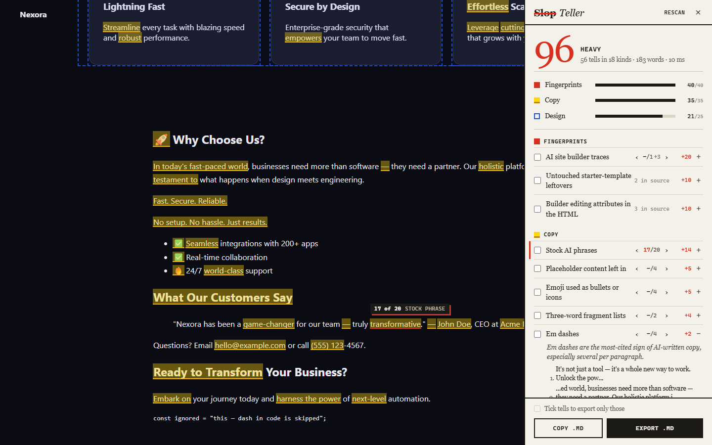

# Slop Teller

A Chrome extension that scores a web page for **AI tells**, marks each one on the page, and exports a Markdown fix list you can hand to an AI assistant.



It counts tells, not proof. Real writers use em dashes, and some brands choose gradients on purpose, so every point in the score comes with its reason.

## Install

It isn't in the Chrome Web Store, so it installs as an unpacked extension:

1. Download `slop-teller-v*.zip` from the [latest release](https://github.com/kingspast21/slop-teller/releases/latest) and unzip it (or clone this repo).
2. Open `chrome://extensions` (or `edge://extensions`, `brave://extensions`).
3. Turn on **Developer mode**.
4. Click **Load unpacked** and pick the `slop-teller` folder (the one with `manifest.json`).
5. Pin the extension, open any site, and click the icon (or press **Alt+Shift+S**). Click again to close.

To scan local `file://` pages, open the extension's details and turn on **Allow access to file URLs**. Chrome doesn't allow extensions on `chrome://` pages or the Web Store.

## What it checks

| Layer | Examples | Max points |
|---|---|---|
| Fingerprints | AI builder scripts, badges, meta tags and preview images, builder hosting domains, editor attributes (`data-lov-id`), untouched starter titles and favicons | 40 |
| Copy | Em dashes, stock phrases, "not just X, it's Y", fragment lists, emoji bullets, generic headings, placeholder content | 35 (per 1,000 words) |
| Design | Gradient text, purple gradients, pill badge above the headline, centred two-button hero, identical icon cards, glass cards, default font | 25 |

Score bands: 0-14 Few tells, 15-39 Some, 40-69 Many, 70+ Heavy.

## Using the panel

- Click a tell's name to jump to the next one on the page. The counter (`‹ 3/20 ›`) shows where you are, the current mark turns red with a "3 of 20" pin, and it wraps around at the end. `‹ ›` step back and forward; **Alt+Up / Alt+Down** do the same from the keyboard. `+3` after the count means three more are in the page source (not on screen).
- Click **+** to see why a tell counts and the full list of places. Click a place to jump straight to it.
- Hover a mark on the page for its reason.
- Click a layer to show or hide its marks.
- **Keep as is** marks a tell as intentional. It stops counting, moves to the export's "Keep as is" list, and is remembered for that site.
- Tick tells to export only those, then **Export .md** (download) or **Copy .md** (clipboard).

## The Markdown export

The file opens with instructions for the assistant (find each item in the repo by its quoted text, fix in context, don't add new tells, leave kept items alone, design items are suggestions), then lists findings by layer with the matched text, its context and a CSS selector.

## Editing the rules

All patterns, weights, caps and the "why / how to fix" wording live in `src/rules.js`. Design detectors are in `src/scanner.js` under the same ids.

## Development

```bash
npm install          # Playwright, for tests only
npm test             # loads the real extension in Chromium against tests/fixtures
node tests/run.mjs https://example.com   # also scan real sites
npm run icons        # redraw icons (needs uv)
npm run zip          # dist/slop-teller-v<version>.zip from the last commit
```

Test output (screenshots, exported .md, results.json) goes to `tests/out/`.

## Privacy

Nothing leaves the browser. The extension only runs on the tab you click it on (`activeTab`), has no host permissions and makes no network requests. "Keep as is" choices are stored locally per site.

## License

MIT. See [LICENSE](LICENSE).
